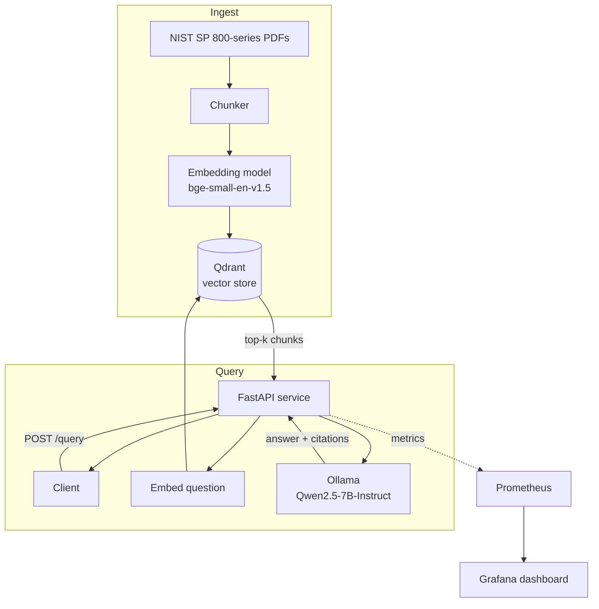

# Airgap RAG

A fully offline, self-hosted retrieval-augmented generation service. No external API calls at
any point in the request path — every model, embedding, and vector lookup runs on local
hardware, which is the constraint a classified or air-gapped network would impose.

> Status: Phase 1 (plan + scaffold). Pipeline, eval, monitoring, and benchmarks land in later
> phases — see [Build phases](#build-phases).

## Architecture



**Request path for `/query`:** embed the question with the same model used at ingest time →
retrieve top-k chunks from Qdrant → build a prompt that includes the chunks and their source
document/section → generate with the local LLM via Ollama → return the answer with citations.
Every step's latency is recorded and exported to Prometheus.

## Stack

| Concern | Choice | Why |
|---|---|---|
| LLM serving | [Ollama](https://ollama.com), CPU | No CUDA on this machine (AMD GPU); Ollama's HTTP API and GGUF quantization management are simple to containerize and reason about |
| LLM | Qwen2.5-7B-Instruct | Strong instruction-following for QA at a size a 6-core CPU can run; Apache 2.0 licensed |
| Quantizations benchmarked | Q4_K_M vs Q8_0 | Same model, two compute/memory/accuracy points — the efficiency story |
| Embeddings | `BAAI/bge-small-en-v1.5` (sentence-transformers) | Small (~130MB), fast on CPU, strong retrieval quality for its size |
| Vector DB | Qdrant | Local, Docker-native, simple filtering + payload support for citations |
| API | FastAPI | Async, typed, trivial to add Prometheus middleware |
| Monitoring | Prometheus + Grafana | Industry-standard pull-based metrics; dashboard JSON is portable |
| Packaging | Docker Compose | One command (`docker compose up`) brings up API, Ollama, Qdrant, Prometheus, Grafana |
| Corpus | NIST SP 800-series publications | Public domain, thematically relevant, mix of policy/technical text |

## Hardware this was built and benchmarked on

- CPU: AMD Ryzen 5 5600X (6 cores / 12 threads)
- RAM: 32 GB
- GPU: AMD Radeon RX 6700 XT (not used for inference — no CUDA; ROCm on Windows was judged
  too fragile to depend on for a one-week build, so this project runs CPU-only by design.
  This is itself part of the story: resource-constrained/air-gapped environments often don't
  have GPUs available either.)
- OS: Windows 11

## Repo layout

```
app/
  main.py          FastAPI app: /health, /ingest, /query, /metrics
  config.py        Settings (env-driven: model names, Qdrant/Ollama URLs, chunk size, top-k)
  rag/
    chunking.py    Document -> overlapping text chunks
    ingest.py      Chunk -> embed -> upsert into Qdrant
    retrieval.py   Query -> embed -> top-k search
    generation.py  Retrieved chunks + question -> prompt -> Ollama -> answer
  metrics.py       Prometheus counters/histograms (latency, tokens/sec, errors)
eval/
  eval_set.jsonl   ~50 question/answer pairs derived from the corpus
  run_eval.py      Scores retrieval hit rate + answer faithfulness, logs results over time
monitoring/
  prometheus.yml
  grafana/dashboards/airgap_rag.json
scripts/
  download_models.sh / .ps1   Pull/verify Ollama models up front
  benchmark_quantization.py   Q4 vs Q8 speed/memory/accuracy table
  degradation_demo.py         Inject a quality regression, show metrics/eval catch it
tests/
docker/
  api.Dockerfile
docker-compose.yml
```

## Build phases

1. **Plan + scaffold** (this phase) — repo structure, Docker Compose skeleton, config.
2. RAG pipeline + API — chunking, embedding, Qdrant ingestion, retrieval, generation,
   `/ingest` and `/query` endpoints with citations.
3. Eval harness — ~50 Q/A pairs from the corpus, retrieval hit-rate + faithfulness scoring,
   results logged over time.
4. Monitoring — Prometheus metrics in the API, Grafana dashboard.
5. Quantization benchmarks + degradation demo — Q4 vs Q8 table; inject a regression
   (noisy/duplicate docs or a worse embedding model) and show eval/metrics catching it.
6. Tests, CI (GitHub Actions: pytest + lint), final README (benchmark tables, eval results,
   design-decisions/tradeoffs section).

## Getting started (once Phase 2+ lands)

```bash
docker compose up --build
```

Then `GET http://localhost:8000/health`, Qdrant dashboard at `:6333/dashboard`,
Prometheus at `:9090`, Grafana at `:3000`.

## Design decisions and tradeoffs

_Filled in during Phase 6, once there are actual benchmark numbers and eval results to
reference instead of plans._
